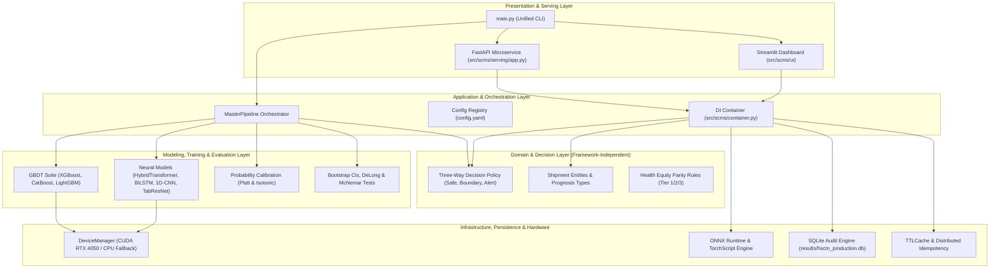

# System Architecture & Technical Design

## 1. Architectural Philosophy
The Healthcare Supply Chain Management (HSCM) Stockout Prediction Platform is engineered following **Clean Architecture** and **Domain-Driven Design (DDD)** principles. Business logic, clinical safety rules, and Three-Way Decision policies are decoupled from external frameworks, persistence databases, web protocols, and hardware acceleration runtimes.

---

## 2. Package Organization (`src/scms/`)

| Package / Module | Responsibility | Inversion Boundary |
| :--- | :--- | :--- |
| `src/scms/decision/` | Three-Way Decision (3WD) Policy, region classification, logistical action mapping. | Zero framework/DB imports (enforced by AST tests). |
| `src/scms/data/` | Dataset cleaning, chronological splitting, leakage guards, train-only fit assertion. | Depends only on pandas, numpy, and torch dataset abstractions. |
| `src/scms/features/` | Feature extraction, date-differencing lead times, historical aggregates. | Fits strictly on training split; zero test lookahead. |
| `src/scms/models/` | GBDT wrappers, PyTorch neural architectures, Ghazvinian multi-objective ANN. | PyTorch, XGBoost, CatBoost, LightGBM. |
| `src/scms/training/` | Multi-seed trainer, early stopping, AMP, Optuna HPO, loss functions. | Torch training loop and mixed-precision engine. |
| `src/scms/evaluation/` | 1000-sample bootstrap CIs, DeLong test, McNemar test, calibration, fairness audits. | Scikit-learn and SciPy statistical engines. |
| `src/scms/serving/` | FastAPI REST controllers, Pydantic schemas, MAUT champion selector, ONNX exporter. | ASGI/FastAPI, Starlette, uvicorn. |
| `src/scms/monitoring/`| Prospective quarterly drift simulation, score PSI, Kolmogorov-Smirnov test. | Telemetry logs and distribution estimators. |
| `src/scms/utils/` | Hardware device management (CUDA/CPU fallback), logging formatters. | Torch CUDA runtime, OS diagnostics. |

---

## 3. Dependency Inversion Rules
1. **Decision Independence**: `src/scms/decision/` contains pure domain logic. It must never import `fastapi`, `starlette`, `streamlit`, `sqlite3`, `torch.onnx`, or `uvicorn`.
2. **Ports and Adapters**: Application use cases depend solely on abstract interfaces (`IPredictor`, `IShipmentRepository`, `ICacheService`). Concrete adapters (`PyTorchModelAdapter`, `RelationalShipmentRepository`, `InMemoryTTLCache`) are wired at startup inside `Container`.
3. **Automated Architectural Gate**: Verified continuously via `pytest tests/test_clean_architecture.py`. Any introduced framework leak breaks CI builds automatically.
