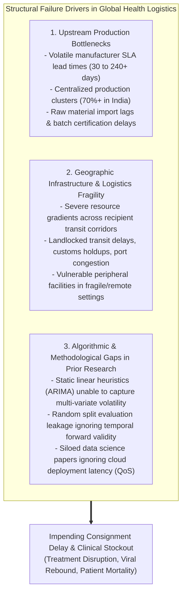
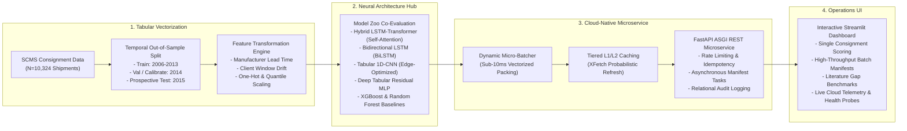

# Cloud-Native Medicine Stockout & Delivery Risk Prediction Platform

[](https://fastapi.tiangolo.com)
[](https://pytorch.org)
[](https://streamlit.io)
[](https://www.docker.com)
[](https://blog.cleancoder.com)
[](LICENSE)

An enterprise-grade, cloud-native intelligence platform designed to forecast pharmaceutical consignment delivery delays and impending clinical stockouts across global healthcare supply chains. Co-evaluates deep learning predictive accuracy, cloud infrastructure Quality of Service (QoS), and algorithmic health equity across international logistics corridors.

---

## Executive Overview & Operational Context

In global public health programs, timely procurement and distribution of essential medicines—specifically Antiretrovirals (ARVs) for HIV/AIDS care and Rapid Diagnostic Test kits (HRDT)—represent the critical lifeline separating clinical stability from community-level viral resurgence. Every consignment coordinated through multilateral relief pipelines (e.g., USAID | PEPFAR) spans multi-continent procurement networks, originating from certified manufacturing sites (predominantly in India) and traversing international freight corridors to reach regional warehouses, district hospitals, and peripheral dispensaries across developing nations.

Within this operational environment, consignment delivery delays directly trigger catastrophic inventory stockouts. When buffer inventories at recipient clinics are exhausted, patient antiretroviral therapy is abruptly interrupted. Clinical interruptions lead rapidly to viral rebound, the rapid emergence of drug-resistant viral strains, increased transmission rates, and avoidable patient mortality. Historically, supply chain logistics has relied on reactive tracking—detecting delivery failures only after consignments breach scheduled delivery windows or when stockrooms are already empty, at which point emergency air shipments are either cost-prohibitive or physically impossible to execute.

---

## Root Causes of Supply Chain Logistics Failure

Consignment delivery failures and medicine stockouts in public health supply chains arise from three interconnected structural vulnerabilities:



1. **Upstream Manufacturer Lead Time Volatility:** Over 70% of global donor-funded antiretrovirals originate from a concentrated cluster of Indian and international manufacturing plants. Contracted manufacturer lead times (the window from purchase order transmittal to factory-gate departure) fluctuate wildly—from 30 to over 240 days—driven by active pharmaceutical ingredient (API) shortages, batch release testing, packaging constraints, and ocean freight container deficits. These upstream delays propagate downstream, completely desynchronizing delivery schedules from recipient clinic treatment windows.
2. **Geographic Resource Gradients & Transit Bottlenecks:** Shipments destined for remote or fragile states (e.g., Democratic Republic of the Congo, South Sudan, Burundi) encounter multi-modal logistical hurdles—including extended customs clearance delays, port demurrage, seasonal road washouts, and limited cold-chain capacity. Conversely, centralized distribution hubs (e.g., South Africa) benefit from advanced port terminals and highway infrastructure. Traditional planning systems treat all destination facilities with uniform assumptions, systematically underestimating stockout risks in underserved peripheral settings.
3. **Algorithmic Disconnect in Prior Research:** Existing academic literature exhibits a profound divide:
   * *Data Science Research* prioritizes complex machine learning algorithms evaluated on synthetic or random train-test splits (introducing massive temporal data leakage), reporting offline F1-scores while ignoring operational inference latency, memory footprints, and compute costs.
   * *Distributed Systems Research* benchmarks cloud auto-scaling, network throughput, and serverless latency, but relies on oversimplified statistical heuristics (e.g., moving averages) incapable of capturing non-linear interactions across product groups, incoterms, freight modes, and shipment valuations.
   * Furthermore, models developed on centralized urban datasets fail when deployed in rural clinics, exacerbating existing geographic health disparities through severe false-negative misclassifications.

---

## Architectural Solution & Methodological Innovations

This platform bridges the divide between algorithmic prediction and scalable cloud engineering through an integrated systems-engineering framework:



### Core Methodological Highlights
* **Prospective Out-of-Sample Temporal Validation:** Strict temporal partitioning (2006–2013 Historical Training, 2014 Validation & Threshold Calibration, 2015 Prospective Test) ensures zero look-ahead bias, reflecting true operational predictive validity on future consignments.
* **Deep Sequence & Attention Modeling:** Captures high-dimensional feature correlations through a **Hybrid LSTM-Transformer** (temporal LSTM sequence modeling combined with multi-head self-attention) and an edge-optimized **Tabular 1D-CNN**, achieving **77.50% recall** on prospective minority-class delivery delays.
* **Dual-Metric Co-Evaluation:** Concurrently evaluates predictive accuracy (Accuracy, Balanced Accuracy, Recall, F1, PR-AUC, Brier score) alongside cloud infrastructure Quality of Service (P50/P95/P99 latency, batch throughput at BS=1/16/64, memory usage, on-disk size).
* **Algorithmic Health Equity Governance:** Embeds a domain policy stratifying recipient countries into three logistical infrastructure tiers (Tier 1 Low-Risk Hubs, Tier 2 Moderate-Risk Nodes, Tier 3 High-Risk Underserved Corridors), calibrating decision thresholds ($\tau^* = 0.21$) to protect vulnerable community facilities against fatal False Negatives.
* **High-Throughput Clean Architecture:** Implements a four-layer hexagonal architecture featuring dynamic micro-batching, a tiered L1/L2 cache with SingleFlight stampede locks, sliding-window rate limiting, and an asynchronous task queue with dead-letter queue (DLQ) support.

---

## Empirical Benchmark Results

Evaluated strictly on the **Prospective 2015 Test Partition** ($N=1,017$ unseen international consignments):

### 1. Predictive Accuracy vs. Cloud Infrastructure QoS Trade-off

| Model Architecture | Test Accuracy | Minority Recall (Late Risk) | F1-Score (Late) | ROC-AUC | PR-AUC | Latency P50 (Single) | Throughput (BS=64) | Disk Size |
| :--- | :---: | :---: | :---: | :---: | :---: | :---: | :---: | :---: |
| **Hybrid LSTM-Transformer** | 70.70% | **77.50%** | 0.3888 | 0.7665 | 0.2474 | 0.46 ms | 26,747 samples/s | 0.49 MB |
| **Bidirectional LSTM (BiLSTM)** | 69.81% | **77.50%** | 0.3804 | 0.7758 | 0.2866 | 0.42 ms | 29,508 samples/s | 0.90 MB |
| **Tabular 1D-CNN** *(Edge Optimal)* | 68.73% | **77.50%** | 0.3705 | 0.7404 | 0.2668 | **0.27 ms** | **45,235 samples/s** | **0.28 MB** |
| **Deep Tabular MLP** | 72.86% | 75.00% | 0.3947 | 0.7397 | 0.2426 | 0.17 ms | 70,299 samples/s | 0.96 MB |
| **XGBoost (Ensemble)** | **75.12%** | 73.33% | **0.4103** | **0.7970** | **0.3836** | 0.33 ms | 108,134 samples/s | 0.38 MB |
| **Random Forest (Ensemble)** | 75.02% | 70.83% | 0.4009 | 0.7877 | 0.3226 | 25.63 ms | 2,440 samples/s | 5.75 MB |
| **Logistic Regression (Linear)** | 60.37% | **82.50%** | 0.3295 | 0.7271 | 0.2374 | 0.06 ms | 947,615 samples/s | 0.002 MB |

### 2. Algorithmic Health Equity & Geographic Tier Stratification

| Model Architecture | Tier 2 Recall (Moderate-Risk Nodes) | Tier 3 Recall (High-Risk Underserved) | Equal Opportunity Difference | Statistical Parity Difference |
| :--- | :---: | :---: | :---: | :---: |
| **Hybrid LSTM-Transformer** | **78.26%** | **77.46%** | **0.7746** | 0.4435 |
| **Bidirectional LSTM (BiLSTM)** | **78.26%** | **77.46%** | **0.7746** | 0.5161 |
| **Tabular 1D-CNN** | **78.26%** | **77.46%** | **0.7746** | 0.4232 |
| **Deep Tabular MLP** | 76.09% | 74.65% | 0.7465 | 0.4355 |
| **XGBoost** | 76.09% | 74.65% | 0.7465 | 0.4516 |
| **Random Forest** | 76.09% | 70.42% | 0.7042 | **0.4073** |
| **Logistic Regression** | **93.48%** | **78.87%** | 0.7887 | 0.4192 |

*Insight:* In high-risk, underserved health facilities (Tier 3: Congo DRC, Nigeria, South Sudan, etc.), deep sequence and convolution models capture **77.46%** of impending delivery failures, missing only 27 shipments, whereas conventional Random Forest missed over 29.5% of delays.

---

## Clean Architecture Component Structure

The repository enforces strict separation of concerns via Clean Architecture (Inward-Pointing Dependency Rule):

```
Implementation/
├── app_streamlit.py                  # Operations Dashboard Entry Point (Streamlit)
├── run_experiments.py                # Offline Training & QoS Benchmarking Pipeline
├── test_api.py                       # Automated Regression & Cloud Integration Test Suite
├── SCMS_Delivery_History_Dataset.csv # Raw SCMS Dataset (N=10,324 consignments)
├── results/
│   ├── models/                       # Checkpoints (.pt, .pkl) & Preprocessor artifacts
│   ├── figures/                      # ROC/PR Curves, QoS Trade-off Plots
│   ├── benchmark_metrics.csv         # Machine Learning Evaluation Results
│   ├── qos_benchmark.csv             # Cloud Infrastructure QoS Benchmarks
│   └── health_equity_benchmark.csv   # Algorithmic Fairness Audit Results
└── src/
    ├── config.py                     # Static paths, seeds, hyperparameters, tier sets
    ├── container.py                  # Composition Root & Dependency Injection Container
    │
    ├── domain/                       # [LAYER 1]: Enterprise Domain Rules (Pure Python)
    │   ├── entities.py               # Immutable domain entities (ShipmentEntity, Prognosis)
    │   └── policies.py               # Business rules (HealthEquityPolicy, RiskPolicy)
    │
    ├── application/                  # [LAYER 2]: Application Business Rules & Ports
    │   ├── ports/                    # Abstract boundary interfaces
    │   │   ├── predictor.py          # IPredictor contract
    │   │   ├── transformer.py        # IFeatureTransformer contract
    │   │   ├── telemetry.py          # ITelemetryRepository contract
    │   │   ├── cache.py              # ICacheService contract
    │   │   ├── repository.py         # IShipmentRepository & IBatchJobRepository
    │   │   └── queue.py              # ITaskQueue contract
    │   └── use_cases/                # Business orchestration
    │       ├── predict_shipment.py   # Single shipment scoring flow
    │       ├── batch_predict.py      # High-throughput batch scoring flow
    │       └── get_qos_metrics.py    # Cloud telemetry extraction flow
    │
    ├── infrastructure/               # [LAYER 3]: Concrete Technology Adapters
    │   ├── adapters/
    │   │   ├── pytorch_adapter.py    # PyTorch nn.Module driver
    │   │   ├── sklearn_adapter.py    # Scikit-Learn / XGBoost estimator driver
    │   │   ├── feature_adapter.py    # Tabular preprocessing driver
    │   │   ├── dynamic_batcher.py    # Adaptive micro-batching inference engine
    │   │   └── telemetry_repo.py     # O(1) circular buffer telemetry adapter
    │   ├── cache/
    │   │   └── cache_service.py      # InMemoryTTLCache (L1) & RedisCacheService (L2)
    │   ├── persistence/
    │   │   ├── database.py           # SQLite/PostgreSQL connection pool & DDL migrations
    │   │   └── shipment_repo.py      # Relational audit logger with cursor pagination
    │   └── queue/
    │       └── task_queue.py         # Resilient worker queue with Decorrelated Jitter
    │
    ├── models/                       # PyTorch Neural Network Modules
    │   ├── hybrid_transformer.py     # Hybrid LSTM-Transformer with Self-Attention
    │   ├── cnn.py                    # Tabular 1D-CNN architecture
    │   ├── lstm.py                   # Bidirectional LSTM architecture
    │   ├── dnn.py                    # Deep Tabular Residual MLP
    │   ├── baselines.py              # Classical ML estimators wrapper
    │   └── trainer.py                # Early stopping, training loops, threshold tuner
    │
    ├── data/                         # Data Engineering & Ingestion Pipeline
    │   ├── dataset.py                # PyTorch Dataset & DataLoader generators
    │   └── preprocessor.py           # Feature engineering, scaling, OHE, country tiers
    │
    ├── deployment/                   # [LAYER 4]: Web Presentation & Delivery
    │   ├── app.py                    # RESTful FastAPI microservice controller
    │   ├── schemas.py                # Hardened Pydantic DTOs & boundary validators
    │   ├── middleware/               # Token-bucket rate limiter & idempotency guard
    │   ├── Dockerfile                # Multi-stage secure container spec
    │   └── docker-compose.yml        # PostgreSQL 16 + Redis 7 + API + Worker cluster
    │
    └── ui/                           # [LAYER 4]: UI Presentation (Streamlit)
        ├── theme.py                  # Design tokens & dark/light CSS injection
        ├── state.py                  # Reactive session state management
        ├── components/               # Atomic primitives, scorecards, telemetry bars
        └── views/                    # Multi-view orchestrators (Tabs 1 to 4)
```

---

## Installation & Quickstart

### Prerequisites
* Python 3.10+ (Tested on Python 3.11 & 3.14)
* Standard C/C++ compiler tools (for optional C-extension acceleration)
* Docker & Docker Compose (for containerized multi-service deployment)

### 1. Local Environment Setup
```bash
# Navigate to the Implementation directory
cd "Implementation"

# Create and activate a virtual environment
python -m venv venv
# On Windows:
.\venv\Scripts\activate
# On Linux/macOS:
source venv/bin/activate

# Install required dependencies
pip install -r requirements.txt
```

### 2. Run the Interactive Operations Dashboard
```bash
streamlit run app_streamlit.py
```
Open your browser to `http://localhost:8501`. The dashboard allows you to:
* Test individual shipment parameters across 7 models with instant scorecards.
* Load 25 unseen prospective 2015 consignments with high-throughput batch vectorization.
* Inspect literature review benchmarks, ROC/PR curves, and health equity disparity plots.
* Monitor live microservice health, memory usage, and QoS telemetry.

### 3. Launch the RESTful FastAPI Microservice
```bash
python -m uvicorn src.deployment.app:app --host 0.0.0.0 --port 8000 --reload
```
Interactive OpenAPI documentation is available at `http://localhost:8000/docs`.

### 4. Execute the Enterprise Test Suite
```bash
python test_api.py
```
Executes automated end-to-end regression tests verifying:
* Kubernetes `/health` liveness/readiness probes.
* Single-consignment prediction with distributed idempotency and L1/L2 cache-hit replay.
* High-throughput synchronous batch matrix scoring.
* Asynchronous batch ingestion, background queue workers, and `/api/v1/jobs/{job_id}` polling.
* Relational audit trail persistence and cursor-based pagination.
* Cloud SLA percentiles (P50, P95, P99).

### 5. Multi-Container Production Deployment (Docker Compose)
To launch the complete enterprise cluster (PostgreSQL 16 + Redis 7 + API Gateway + Worker):
```bash
docker compose -f src/deployment/docker-compose.yml up --build -d
```

---

## API Reference & Core Endpoints

| Endpoint | Method | Input Payload / Parameters | Description & Guarantees |
| :--- | :---: | :--- | :--- |
| `/health` | `GET` | None | Service liveness probe: returns active model, device, memory RSS, and uptime. |
| `/predict` | `POST` | `ShipmentInput` JSON + optional `Idempotency-Key` | Real-time single order scoring. Enforces rate limits, cache-aside, and audit logging. |
| `/predict/batch` | `POST` | `BatchShipmentInput` (1 to 1,000 shipments) | Synchronous vectorized matrix scoring. Returns aggregate latency and throughput. |
| `/api/v1/predictions/batch/async` | `POST` | `BatchShipmentInput` JSON | Asynchronous bulk scoring. Enqueues task to background worker, returning `job_id`. |
| `/api/v1/jobs/{job_id}` | `GET` | `job_id` path string | Polling endpoint for background batch execution progress, throughput, and status. |
| `/api/v1/audit/shipments` | `GET` | `country`, `risk_tier`, `limit`, `cursor` | Cursor-paginated historical audit trail of all model inferences from database. |
| `/api/v1/cache/stats` | `GET` | None | Operational telemetry: cache hits, misses, hit ratio %, and memory footprint. |
| `/qos_metrics` | `GET` | None | SLA latency percentiles (P50, P95, P99, Mean, Min, Max) calculated over bounded buffer. |

### Example Request (`POST /predict`)
```bash
curl -X POST "http://localhost:8000/predict" \
     -H "Content-Type: application/json" \
     -H "Idempotency-Key: c9d8e7f6-1234-5678-abcd-ef0123456789" \
     -d '{
       "Country": "Congo, DRC",
       "Scheduled_Delivery_Date": "2026-11-20",
       "PO_Sent_to_Vendor_Date": "2026-08-01",
       "Manufacturer_Lead_Time_Days": 120.0,
       "Product_Group": "ARV",
       "Sub_Classification": "Pediatric",
       "Shipment_Mode": "Air",
       "Fulfill_Via": "Direct Drop",
       "Vendor_INCO_Term": "CIP",
       "Vendor": "Aurobindo Pharma Limited",
       "Manufacturing_Site": "Aurobindo Unit III, India",
       "First_Line_Designation": "Yes",
       "Line_Item_Quantity": 25000.0,
       "Line_Item_Value": 125000.0,
       "Pack_Price": 5.0,
       "Unit_Price": 0.08,
       "Unit_of_Measure_Per_Pack": 60.0,
       "Weight_Kilograms": "1450.0",
       "Freight_Cost_USD": "8900.0",
       "Line_Item_Insurance_USD": 140.0
     }'
```

### Example Response
```json
{
  "late_delivery_risk": 0,
  "risk_probability": 0.0946,
  "risk_tier": "Low Risk",
  "country_tier": "Tier_3_High_Risk_Underserved",
  "qos_latency_ms": 1.254
}
```

---

## Research Attribution & Academic Citation

This implementation forms the experimental foundation of the combined research project in **Cloud Computing (CC)** and **Deep Learning (DL)** at **Navrachana University**:

* **Author:** Parth Jivani (M.Tech Computer Science & Engineering)
* **Supervisor:** Dr. Yogesh Chaudhari, Prof. Rupali Shinde
* **Institution:** Navrachana University, Vadodara, Gujarat, India
* **Primary Reference:** *A Systematic Review of Cloud Computing and Deep Learning Architectures for Resilient Healthcare Supply Chain Management*.
